<p align="center">
  
</p>

# URTC Web Studio

<p align="center">
  🇺🇸 <b>English</b> |
  <a href="README_spa.md">🇪🇸 Español</a> |
  <a href="README_fra.md">🇫🇷 Français</a> |
  <a href="README_ita.md">🇮🇹 Italiano</a> |
  <a href="README_deu.md">🇩🇪 Deutsch</a> |
  <a href="README_zho.md">🇨🇳 简体中文</a> |
  <a href="README_jpn.md">🇯🇵 日本語</a> |
  <a href="README_por.md">🇵🇹 Português</a>
</p>


<p align="center">
  
  
  
  
</p>


A browser-based companion to the **Universal Robot Tool Controller (URTC)** -
a React/Vite single-page app that is meant to talk to real URTC hardware (it has never been run against any) over a USB-CAN
adapter via the [Web Serial API](https://developer.mozilla.org/en-US/docs/Web/API/Web_Serial_API),
using the same SLCAN framing and CAN protocol as the two desktop companion
tools, [URTC Flasher](https://github.com/JuanenRac/URTC-FLASHER) and
[URTC Tester](https://github.com/JuanenRac/URTC-TESTER). The aim is to bring the main workflows of those two tools into a single browser tab, not a simplified demo of them; it does not reach full parity yet (see "Not covered yet" below) - the Flasher Studio and Tester Studio tabs send and receive the
real CAN frames described in `docs/CANBUS.TXT` of the
[URTC firmware repo](https://github.com/JuanenRac/URTC).

**Honesty check - what actually runs today:** `npm test` (Vitest) covers the pure logic: SLCAN parsing, request/answer matching, firmware image and manifest checks, tool limits, confirmations, the rules that keep the simulator apart from the real bus, trace export and the eight interface languages. The screens and the Web Serial transport itself have no automated tests, and none of this has been run against a real URTC board in this environment (no USB-CAN adapter here to test with): Flasher Studio, Tester Studio and the CAN Bus Protocol Analyzer are real code verified only by those tests, type-checking (`npm run lint`) and code review. Control/OLED/Specs-BOM/Thermal IR Inspection are openly labeled sandbox tabs with zero CAN traffic. See `CHANGELOG.md` for exactly what has shipped so far.

---

> **Safety and security status:** this ecosystem is not a certified safety system, and no populated URTC board exists yet. The bootloaders check firmware images with CRC32 and a shared-key HMAC-SHA256, not with an asymmetric signature (planned); the published application images are signed with the public development key (`signing_key_kind: dev`), so anyone can produce an image the bootloader accepts; nothing has been transmitted to a real board. Read the [security baseline](https://github.com/JuanenRac/URTC-DOCS/blob/main/docs/SECURITY_BASELINE.md) and the [threat model](https://github.com/JuanenRac/URTC-DOCS/blob/main/docs/THREAT_MODEL.md) before relying on any statement here for the safety of a person.

## 📋 At a glance

| | |
|---|---|
| Version | `0.2.9` |
| Maturity | Functional |
| Stack | Web Serial API / TypeScript |
| Target | A web browser on the user's PC |
| On real hardware | Simulated only: tested against emulators, fakes or simulators; no run on real hardware is recorded for this version |

## 🧭 What's real vs. what's a sandbox

This app has two kinds of tabs:

- **Real, hardware-driven tabs** - Flasher Studio, Tester Studio, and the CAN
  Bus Protocol Analyzer. These only do anything once you've connected a real
  USB-CAN adapter (top-right header button); every command they send and
  every reading they show comes from the CAN bus (this path has never been run against a real adapter or board). This includes the
  real **thermal camera reading** - Tester Studio's "Thermal Inspection"
  panel (`0x250`/`0x251`/`0x254`/`0x255`) queries the tool head's actual
  MLX90640 IR array over CAN.
- **Offline sandbox tabs** - Control (tool catalog), OLED, Specs/BOM, and
  Thermal IR Inspection. These let you explore the 25-tool catalog, preview
  the OLED status screens, browse the BOM/pinouts, and view a simulated
  thermal camera feed, all without any hardware connected. The "FW v0.0 /
  v0.1" toggle in the header only affects these sandbox tabs (which tool
  profiles a given firmware build would unlock) - it has no bearing on what a
  real, connected board reports.
  - **Do not confuse the two thermal views**: the standalone "Thermal IR
    Inspection" tab (`ThermalCameraViewer.tsx`) is 100% client-side
    `Math.random()` noise with no CAN traffic at all - it's a UI mockup, not
    a sensor reading. The real MLX9064x data only ever appears inside Tester
    Studio's "Thermal Inspection" panel, and only once hardware is
    connected.

## 🔌 Hardware you need

- A USB-CAN adapter running **SLCAN** firmware (e.g. a CANable running
  `candlelight`/`slcan`, or any adapter that speaks the standard `lawicel`
  SLCAN serial protocol) - the same adapter class both desktop tools support
  via their own Serial transport.
- The bus set to **500 kbit/s**. On connect the app tries 500, 250, 125 kbit/s and the other standard rates in turn and keeps the first one at which a board answers a version query; there is no way yet to choose the rate by hand or to listen without a board answering.
- A browser with Web Serial support - **Chrome or Edge**. Firefox and Safari
  don't implement Web Serial and won't be able to connect at all.
- Web Serial requires either a secure context (HTTPS) or `localhost` - and it
  cannot be used from inside an iframe. If you're previewing this app inside
  an embedded frame, open it in its own tab first.

## 🛡️ CAN Frame Validation

Both directions of the SLCAN link are validated before anything reaches the
UI or the wire (`src/hooks/useSerialCanBus.ts`):

- **Outbound** - `sendFrame()` refuses to serialize a command whose
  identifier falls outside the 11-bit standard CAN range (`0x000`-`0x7FF`),
  whose payload exceeds 8 bytes, or whose payload contains a byte outside
  `0x00`-`0xFF`. The UI shows "Refusing malformed CAN frame: ..." instead of
  writing invalid text to the serial port.
- **Inbound** - `processBuffer()` requires a real
  `t<3-hex ID><1-hex DLC 0-8><hex payload>` match before turning a received
  SLCAN line into a `CanFrame`; a DLC outside `0`-`8` or a payload shorter
  than its own declared length is logged to the console and dropped rather
  than handed to a tool panel as a `NaN` byte. An optional trailing adapter
  timestamp is still accepted after a valid payload.

## ⚡ Flasher Studio - real feature coverage

Ported from `URTC-FLASHER`'s own `flasher_protocol.py`, against the same CAN
IDs:

- **CAN-OTA update of the main board** (`0x7F0`-`0x7F7`): enter-bootloader
  trigger, shared-key HMAC-SHA256 chunks (tested against a simulator only), paged transfer with page-ACK flow control and
  retry/backoff, CRC32 + declared-version END_UPDATE, and terminal-status
  handling (including recovering from a lost confirmation frame the same way
  the desktop tool does - it re-queries the version rather than reporting a
  false failure).
- **CAN-OTA update of the expansion slave** (`0x210`-`0x219`, relayed through
  the main board's own I2C bridge) - same signing/CRC scheme, no page-ACK or
  heartbeat on this path (matches the real protocol; progress is polled, not
  pushed).
- **Downgrade authorization** (`0x7FD`) - a confirmation-gated checkbox that
  authorizes the current attempt to bypass the bootloader's anti-rollback
  check, for a deliberate revert to an older release.
- **F-RAM erase before flashing** (`0x192`), optional, main board only.
- **CAN error counter query** (`0x7FB`/`0x7FC`, TEC/REC read straight from
  the CAN controller's own error registers) - tells a genuine bus problem
  apart from an application/bootloader-side issue.
- **Firmware readback / backup over CAN** (`0x7FE`/`0x7FF`) - reads the main
  slot's current contents back before you overwrite it, paced 2KB/page with
  host ACKs, and saves it as a `.bin` download.
- **Live board version query** (`0x7F8`/`0x7F9`/`0x7FA`/`0x7E9`) - shows the real
  responder (app or bootloader), HardwareID, and version, not a simulated
  toggle.
- **Published signature and digest** - every image from the URTC build ships
  with `<file>.manifest.json` (version, `sha256`, and the `hmac_sha256` value the bootloader expects, a shared-key HMAC-SHA256 and not an asymmetric signature) and `<file>.sha256`. The app sends that
  published signature, a manifest `sha256` that does not match the file
  **blocks** the flash, and the manifest's version is what gets reported to
  the bootloader. A file picked from disk has no manifest: it can only be
  flashed with a signing key typed in for that one flash (bench boards),
  unless its `.manifest.json` is picked together with it.
- **Firmware patch number** (`0x7E9`, and the extended `0x218` of the slave) -
  the installed firmware and the selected image are shown as
  major.minor.patch. The patch takes part in the comparison only when both
  sides carry one, a board that predates it (it sends no `0x7E9`) keeps
  working with major.minor, and the patch goes into END_UPDATE only towards a
  bootloader that announced it. The log says whether the image is older,
  equal or newer than what the board reported.
- **Firmware from the newest GitHub release** - the binaries are assets of the
  release of each URTC version, not files in git. The list comes from the
  releases API of `JuanenRac/URTC` (only the application images of the selected
  board, each with its `.sha256` and `.manifest.json`); a downloaded image must
  match the digests the release publishes, and the image, manifest and
  signature checks stay. GitHub serves the files from a host that sends no CORS
  headers, so a browser may be unable to download them: the log then says so,
  and the image can be taken from the bundled folder, or downloaded from the
  release page and picked with Browse together with its `.manifest.json`.
- **Board config**: expansion board type / MLX9064x sensor variant / free
  tool configuration (ID pins `11111`) / peripheral info & serial number -
  `0x1A0`-`0x1A7`.

### SWD/JTAG - not available from a browser, by design

There is no Web API that can drive an SWD/JTAG debug probe - Web Serial only
talks to serial-framed devices (like a USB-CAN adapter), not a probe's own
protocol, and STM32CubeProgrammer/pyOCD are native subprocesses the desktop
tool shells out to. This is a structural limitation of running in a browser
sandbox, not a missing feature here. The SWD/JTAG tab in Flasher Studio
explains the exact commands the desktop `URTC Flasher` tool would run
locally, for reference - use that tool directly for full-chip programming,
option-byte/RDP checks, or a full-flash backup before a mass erase.

## 🧰 Tester Studio - real feature coverage

Ported from `URTC-TESTER`'s own `tester_tool_panels.py` /
`tester_common_panels.py`, against the same CAN IDs:

- A panel per tool (soldering iron + wire feeder, shared plain-stepper
  motion tools, vacuum pickup, drill, AOI, laser, 3D printer heater/motion/
  fans, scan probe, electromagnet, spot/ultrasonic welder, flying probe
  incl. the ADS1115 advanced path, UV curing, hot air rework, crimping,
  thermal inspection, paste jetting), each sending the tool's real command
  bytes and decoding its real telemetry.
- **Active-checkbox + keepalive** for every tool with a firmware-side
  communication watchdog (soldering iron, laser, UV curing, hot air rework,
  3D printer nozzle - 150ms resend under a 250ms watchdog; 3D printer layer
  fan - 400ms resend under its own 1000ms watchdog), the same resend
  intervals the desktop tool uses. Unchecking it, replacing the panel,
  changing tab, disconnecting or closing the page sends the tool's off
  command.
- **Global Controls** (`0x100`), **Expansion Board** SPI passthrough +
  TMC DIAG0 query (`0x180`-`0x183`), **F-RAM** query/erase (`0x190`-`0x192`),
  **Self-Test** (safe, at-rest checks per tool), a **Raw Bus Monitor** with
  `.trc`/`.asc` trace export, and a **Custom Frame** injector with an
  optional repeat interval - validated like the CAN Bus Protocol
  Analyzer's own frame injector: an identifier outside `0`-`7FF`, an invalid
  data byte or more than 8 bytes is refused with a message, never masked,
  dropped or cut. Identifiers that only the board transmits are refused, and
  writes to the board memory, bootloader commands and actuator commands are
  confirmed first.
- **Detect Hardware** queries the real active tool (`0x110`/`0x111`) and
  board version (`0x7F8`/`0x7F9`), and a declared critical error
  (`0x111` byte 1) surfaces as a live fault banner.

### Simulator separation and confirmations (software checks, not safety functions)

- The sandbox tabs (Control, OLED, Thermal IR) transmit nothing. Their frames are marked SIM, and while a board is connected they produce no simulated answer. Of the protocol analyzer's predefined messages only plain queries are sent to a connected board; the rest stay simulated.
- Tester Studio shows a tool panel only for the tool the board itself reported (`0x111`), and none before the board has answered.
- Laser, drill, UV curing, welding, heaters, motion, paste jetting, writes to the board memory and risky hand-typed frames ask for confirmation first.

### Not covered yet

- The thermal inspection error counters (`0x1AA`/`0x1AB`).
- A listen-only mode and choosing the bitrate by hand: a bus on which no board answers cannot be joined.
- Reading the thermal image does not check that the sensor is ready first and does not retry a lost chunk.
- Downloading a firmware file straight from the GitHub release inside the browser: GitHub serves release files from a host without CORS headers, so the download may be blocked (the bundled image, or a file picked from disk with its `.manifest.json`, always work).

## 🔐 Security note: no signing key in this app

Since 0.2.3 this app contains **no** HMAC-SHA256 signing key. The URTC build
signs every application image itself (with a private key on release builds only; the published images use the public development key)
and publishes the signature next to it; Flasher Studio only transports that
signature - the same model as the desktop `URTC Flasher`. Nothing secret is
shipped in the JS bundle, so the page can be hosted publicly.

The one exception is a self-built image with no manifest, for a bench board:
the app then asks for the signing key, keeps it in memory for that single
flash and never stores it. Images built with the PUBLIC development key
(`signing_key_kind: "dev"` in the manifest) only install on boards whose
bootloader was built the same way - the log says so. See URTC's
`docs/FIRMWARE_SIGNING.TXT`.

`public/firmware/` holds exactly the files URTC published (same names, same
bytes, with their sidecars). The URTC binaries are not in git: they are assets
of each version's GitHub release. `npm run sync-firmware` downloads the newest
release (`npm run sync-firmware -- --tag v0.3.5` for a given one), or takes a
local folder as an argument (`npm run sync-firmware -- ../URTC/firmware` for a
bench build). Either way it checks every digest and the signature fields before
touching `public/firmware/`, and regenerates `src/lib/bundledFirmware.ts`; a
test verifies the bundle against its manifests.

## 🚀 Getting Started

### Prerequisites
- Node.js 20 LTS+
- npm

### Installation

```bash
git clone https://github.com/JuanenRac/URTC-WEB-STUDIO.git
cd URTC-WEB-STUDIO
npm install
```

### Development Mode

Runs the app with Vite's dev server and live-reloading:
- **Windows:** double-click `dev.bat` or run `npm run dev`
- **Linux/Mac:** run `./dev.sh` or `npm run dev`

Then open `http://localhost:3000` in Chrome or Edge.

### Static Build

Compiles into a static, optimized bundle in `dist/`:
- **Windows:** double-click `build.bat` or run `npm run build`
- **Linux/Mac:** run `./build.sh` or `npm run build`

This is a plain static site - there's no bundled server component (unlike
`HYDRA-UMC STUDIO`'s own `server.ts`). Preview the built `dist/` folder
locally with:

```bash
npm run preview
```

or serve `dist/` with any static file host of your choice. `npm run lint`
runs the TypeScript compiler in check-only mode.

### Versioning

`package.json`'s `version` (and the matching `version` in
`urtc.project.json`) bumps automatically on every real `build.bat`/
`build.sh` run - `bump_manifest_version.py` runs as step 1, before `npm
install && npm run build`, reads the current version straight out of
`package.json`, increments it, writes it back, syncs the manifest, and adds
a bare CHANGELOG entry if that version doesn't already have one. `npm run
build` (`vite build`) on its own is deliberately compilation-only and never
touches the version - `scripts/bump-version.mjs` did this job in an earlier
`prebuild`-hook design, but that script is legacy today, kept only for
reference (see its own header comment); `npm run dev`/`lint`/`preview` never
touch the version either way. This is not Semantic Versioning: it's a
base-10 odometer. The patch digit increments by one; once it would roll past
9 it resets to 0 and the minor digit increments instead (`0.1.9` -> `0.2.0`,
never `0.1.10`); the same carry cascades from minor into major. See
`CHANGELOG.md` for the version history and a summary of past work on this
project.

## 📖 Further Documentation

- [`docs/ARCHITECTURE.md`](docs/ARCHITECTURE.md) — how the UI, persisted
  settings, and external transport authority stay separate, and why the
  sandbox tabs must expose offline/unavailable states rather than present
  simulated data as live.
- [`docs/BUILD_AND_RUN.md`](docs/BUILD_AND_RUN.md) — the non-mutating
  `build-test.bat`/`.sh` validation path (TypeScript + tests, no version or
  CHANGELOG changes), `dev.bat`/`.sh` for local development, and why OTA
  signing material never belongs in browser configuration.
- [`docs/INTEGRATION_CONTRACT.md`](docs/INTEGRATION_CONTRACT.md) — what this
  client must do with an unknown schema, missing target identity, or a
  malformed API result, and why real flash authority stays server-side or
  in the dedicated desktop tools.

## 🛠️ Technology Stack
- **Language:** TypeScript
- **Frontend Framework:** React 18
- **Build Tool:** Vite
- **Styling:** Tailwind CSS
- **Icons:** Lucide React
- **CRC32:** `crc-32` - firmware image integrity check, mirrors the
  bootloader's own CRC32 computation
- **Hardware transport:** Web Serial API + SLCAN framing (no native
  dependencies, no companion backend server)

## 📂 Repository Structure

```
/
├── src/
│   ├── App.tsx                     Root component - tab state, hardware state, CAN
│   │                                frame logging, and the handlers wired into every
│   │                                tab below (including CAN OTA start/readback and
│   │                                the CAN Bus Analyzer's own frame injector)
│   ├── main.tsx                    Vite/React entry point
│   ├── i18n.ts                     i18next setup - en/es/de/fr/it/zh/ja, persisted
│   │                                to localStorage
│   ├── index.css                   Tailwind entry point
│   ├── types.ts                    Shared TypeScript types (CanFrame, HardwareState,
│   │                                FlasherState, ExpansionBoardType, ...)
│   ├── vite-env.d.ts                Vite's own ambient type declarations
│   ├── components/
│   │   ├── Header.tsx               Top bar: connect/disconnect button, active tool
│   │   │                            name, FW v0.0/v0.1 sandbox toggle
│   │   ├── Sidebar.tsx              Left nav - the 7 tabs described in this README
│   │   ├── ToolCatalog.tsx          Sandbox tab: the 25-tool catalog, tool selection,
│   │   │                            setpoint control
│   │   ├── OledDisplay.tsx          Sandbox tab: OLED status-screen preview
│   │   ├── SpecsAndBomViewer.tsx    Sandbox tab: BOM/pinout browser
│   │   ├── ThermalCameraViewer.tsx  Sandbox tab: simulated MLX90640 feed - 100%
│   │   │                            Math.random(), no CAN traffic at all (see
│   │   │                            "What's real vs. what's a sandbox" above)
│   │   ├── HardwarePanel.tsx        Sandbox jumper/LED/expansion-board control panel,
│   │   │                            used inside the Control and OLED tabs
│   │   ├── CanBusAnalyzer.tsx       Real tab: raw CAN frame log, custom frame
│   │   │                            injector, preset command triggers
│   │   ├── FlasherStudio.tsx        Real tab: CAN-OTA UI (main + expansion slave) and
│   │   │                            the SWD/JTAG capability explainer
│   │   ├── TesterStudio.tsx         Real tab: per-tool live control/telemetry, built
│   │   │                            from the tester/ folder below
│   │   └── tester/
│   │       ├── ToolPanels.tsx       One panel per tool profile - real command bytes,
│   │       │                        real telemetry decode, per-tool watchdog keepalive
│   │       ├── GlobalPanels.tsx     Global Controls, Expansion Board, F-RAM,
│   │       │                        Self-Test, Raw Bus Monitor, Custom Frame injector
│   │       └── shared.tsx           Shared UI primitives (Section, Field, button/input
│   │                                classes, safeInt)
│   ├── data/
│   │   └── toolsData.ts             The 25 TOOL_PROFILES - names, defaults, icons for
│   │                                the sandbox tabs
│   ├── hooks/
│   │   ├── useSerialCanBus.ts       Web Serial + SLCAN transport - connect/disconnect,
│   │   │                            frame TX/RX, per-ID waitForFrame with a bounded
│   │   │                            rx buffer and a 500-frame queue cap
│   │   ├── useFlasher.ts            CAN-OTA state machine (main board + expansion
│   │   │                            slave), mirrors flasher_protocol.py
│   │   └── useKeepalive.ts          Fixed-interval resend hook backing every tool's
│   │                                active-checkbox watchdog keepalive
│   ├── lib/
│   │   ├── flasher.ts               OTA protocol constants, CRC32/HMAC helpers,
│   │   │                            manifest parsing (no signing key)
│   │   ├── boardVersion.ts          Version queries: 0x7F9/0x7FA/0x7E9 and the slave's 0x217/0x218
│   │   ├── githubRelease.ts         Images of the newest GitHub release and their download
│   │   ├── firmwareImage.ts         Image checks, manifest target and version (with patch)
│   │   ├── firmwareSignature.ts     Picks the signature to send: the published one,
│   │   │                            or a key typed in for one flash; sha256 check
│   │   ├── quickState.ts            0x111 decoding (thermal fault, reset cause)
│   │   ├── bundledFirmware.ts       Generated by scripts/sync-firmware.mjs
│   │   └── canIds.ts                CAN ID constants for Tester Studio - mirrors
│   │                                 tester_config.py byte-for-byte
│   └── locales/                     UI strings - en.json, es.json, de.json, fr.json,
│                                     it.json, ja.json, zh.json, pt.json
├── scripts/
│   ├── bump-version.mjs             Dependency-free version-bump script; legacy
│   │                                 today, kept for reference only - superseded
│   │                                 by bump_manifest_version.py (see "Versioning")
│   └── sync-firmware.mjs            Copies the URTC release assets (or a local
│                                     folder) into public/firmware/, digests
│                                     checked - npm run sync-firmware
├── public/
│   └── firmware/                    Bundled .bin/.elf/.hex for the main application,
│                                     main bootloader, expansion slave application, and
│                                     expansion slave bootloader
├── images/
│   ├── URTC_WEB_STUDIO_BANNER.svg   Full logo banner (shown at the top of this README)
│   ├── URTC_APP_ICON_NEW.svg        App icon
│   ├── urtc_custom_icon.svg         App icon, same artwork
│   └── urtc_icon.ico                Favicon
├── index.html                       Vite entry HTML
├── vite.config.ts                   Vite + Tailwind plugin config
├── tsconfig.json                    TypeScript config
├── .env.example                     No variable is read by the app
├── dev.bat / dev.sh                 Install deps + start the Vite dev server
├── build.bat / build.sh             Install deps + produce the static dist/ build
├── tools/
│   └── ci_validate.py               Manifest/CHANGELOG/docs validation used by CI
├── bump_manifest_version.py         Real build-time version bump (package.json + manifest, see "Versioning"); `--sync` mode also exists for accepting one prior native-only bump
├── package.json
├── CHANGELOG.md                     Version history and a summary of past work
├── LICENSE
├── README.md                        This file
├── docs/
│   ├── ARCHITECTURE.md
│   ├── BUILD_AND_RUN.md
│   └── INTEGRATION_CONTRACT.md
└── README_spa.md / README_ita.md / README_fra.md / README_deu.md / README_zho.md / README_jpn.md  <- translations
```

## 📜 LICENSE

URTC Web Studio is (c) 2026 JuanenRac (Electro Hobby 3D). This notice must
be included in any distributions of this project or derivative works.

This project consists of source code and its own documentation, made
available under different licenses - each suited to what it actually
covers:

1. The source code (everything under `src/`, plus the Vite/TypeScript
   config that builds it) is available under the **GNU General Public
   License v3.0 (GPL-3.0)**. Full text at
   https://www.gnu.org/licenses/gpl-3.0.html.

2. The documentation (this README and its own translations -
   `README_spa.md`, `README_ita.md`, `README_fra.md`, `README_deu.md`,
   `README_zho.md`, `README_jpn.md`) is
   available under **Creative Commons Attribution-ShareAlike 4.0
   International (CC BY-SA 4.0)**. Full text at
   https://creativecommons.org/licenses/by-sa/4.0/.

This tool is the browser-based companion to the
[URTC (Universal Robot Tool Controller)](https://github.com/JuanenRac/URTC)
project - see that project's own repository for the board firmware,
hardware designs, and full protocol documentation this tool implements
against. URTC's own firmware is GPL-3.0 and its hardware designs are
CERN-OHL-S v2; this tool's own license here doesn't extend to that separate
project, and vice versa. Two desktop-native alternatives covering the same
ground also exist: [URTC Flasher](https://github.com/JuanenRac/URTC-FLASHER)
and [URTC Tester](https://github.com/JuanenRac/URTC-TESTER).

If you build on this project, keep the licensing split in mind: code
changes should stay GPL-3.0, documentation derivatives should stay CC
BY-SA - each with attribution back to this project and its author.

## 🔗 Related Projects

This project is part of the HYDRA-UMC robotics ecosystem by the same author (JuanenRac / Electro Hobby 3D). Worth knowing about, since a request might actually be about one of these rather than this repository.

**Parent Project**
- **[URTC](https://github.com/JuanenRac/URTC)** — firmware for the physical Universal Robot Tool Controller PCB, 25+ tool profiles over CAN bus; the parent this repo is one specific tool of, within its own CAN-bus tooling family.

**Sibling Projects** — the other tools of URTC's own CAN-bus tooling family
- **[URTC-FLASHER](https://github.com/JuanenRac/URTC-FLASHER)** — desktop GUI flashing tool for URTC boards, CAN-OTA plus full-chip SWD/JTAG — same SLCAN/CAN protocol as this browser-based app, which is the no-install alternative to it.
- **[URTC-TESTER](https://github.com/JuanenRac/URTC-TESTER)** — desktop live CAN-bus diagnostic tool for URTC boards, one panel per tool profile — same SLCAN/CAN protocol as this browser-based app, which is the no-install alternative to it.

**Directly Related**
- **[HYDRA-UMC-TOOL-CLI](https://github.com/JuanenRac/HYDRA-UMC-TOOL-CLI)** — fleet CLI with a real, stable exit-code contract, a genuine live client of HYDRA-UMC-SERVER's own API — a terminal/command-line alternative to this browser-based tool.

**Also Part of the Ecosystem**

*Core Hardware & Platform*
- **[HYDRA-UMC](https://github.com/JuanenRac/HYDRA-UMC)** — the robot-arm motherboard design: CM5 host + dual-core STM32H745, meant to orchestrate up to 8 tool arms over CAN-OTA/SPI-OTA (firmware at an early stage; no populated board yet).
- **[HYDRA-UMC-OS](https://github.com/JuanenRac/HYDRA-UMC-OS)** — reproducible Raspberry Pi OS product layer for the CM5: read-only agent, validated config/profiles, WiFi first-contact provisioning.
- **[HYDRA-UMC-SDK](https://github.com/JuanenRac/HYDRA-UMC-SDK)** — the shared JSON-Schema contract and software job-gate boundary every bridge validates its commands against (not a certified safety function).
- **[HYDRA-UMC-CONNECTOR-HUB](https://github.com/JuanenRac/HYDRA-UMC-CONNECTOR-HUB)** — declarative adapter-manifest registry and validator for external-machine connectors; extends the SDK's own contract idea to external machines without replacing the industrial-gateway projects.

*Core Backend & Clients*
- **[HYDRA-UMC-SERVER](https://github.com/JuanenRac/HYDRA-UMC-SERVER)** — the real headless backend (REST/WebSocket) every control client actually talks to.
- **[HYDRA-UMC-STUDIO](https://github.com/JuanenRac/HYDRA-UMC-STUDIO)** — web control dashboard with real-time multi-robot 3D visualization.
- **[HYDRA-UMC-SUITE](https://github.com/JuanenRac/HYDRA-UMC-SUITE)** — desktop (PySide6) swarm command center for multiple servers at once, packaged as a standalone executable.
- **[HYDRA-UMC-ANDROID-CONTROL](https://github.com/JuanenRac/HYDRA-UMC-ANDROID-CONTROL)** — native Android control app with biometric login and a paired Wear OS companion.
- **[HYDRA-UMC-IOS-CONTROL](https://github.com/JuanenRac/HYDRA-UMC-IOS-CONTROL)** — iOS/iPadOS control app (Flutter) with real-time WebSocket sync.
- **[HYDRA-UMC-DSI](https://github.com/JuanenRac/HYDRA-UMC-DSI)** — native touch UI for the onboard 7" DSI touchscreen, embedded on the CM5 itself.
- **[HYDRA-UMC-EDITOR-URDF](https://github.com/JuanenRac/HYDRA-UMC-EDITOR-URDF)** — desktop graphical URDF creator/editor that pushes finished models into STUDIO's own catalog.
- **[HYDRA-UMC-EDITOR-STL](https://github.com/JuanenRac/HYDRA-UMC-EDITOR-STL)** — desktop STL model editor, transforming/replacing/removing/adding real parts in the same model catalog HYDRA-UMC-EDITOR-URDF also edits.
- **[HYDRA-UMC-BRIDGE-AMR](https://github.com/JuanenRac/HYDRA-UMC-BRIDGE-AMR)** — coordination boundary for AGV/AMR fleets via a VDA 5050 MQTT publisher (tested against an emulated fleet only).
- **[HYDRA-UMC-BRIDGE-CNC](https://github.com/JuanenRac/HYDRA-UMC-BRIDGE-CNC)** — high-level CNC-cell coordinator with GRBL status/control-byte access (tested against an emulator only).
- **[HYDRA-UMC-BRIDGE-DROIDS](https://github.com/JuanenRac/HYDRA-UMC-BRIDGE-DROIDS)** — coordination boundary for legged/humanoid droids, with a Boston Dynamics Spot command sender (tested against an emulator only).
- **[HYDRA-UMC-BRIDGE-LASER](https://github.com/JuanenRac/HYDRA-UMC-BRIDGE-LASER)** — laser-cell coordinator reading 3 key/enclosure/interlock GPIO signals (tested against a fake chip only; it cannot arm or fire a laser).
- **[HYDRA-UMC-BRIDGE-OPENPNP](https://github.com/JuanenRac/HYDRA-UMC-BRIDGE-OPENPNP)** — safe high-level board-flow coordinator for OpenPnP pick-and-place.
- **[HYDRA-UMC-BRIDGE-PRINTER3D](https://github.com/JuanenRac/HYDRA-UMC-BRIDGE-PRINTER3D)** — safe coordination boundary for Moonraker/Klipper 3D printers, with real gated job commands.
- **[HYDRA-UMC-BRIDGE-ROS2](https://github.com/JuanenRac/HYDRA-UMC-BRIDGE-ROS2)** — coordinator with a lazily imported rclpy ROS 2 transport (not yet run against a ROS 2 installation).
- **[HYDRA-UMC-BRIDGE-UAV](https://github.com/JuanenRac/HYDRA-UMC-BRIDGE-UAV)** — coordination boundary for camera-equipped UAVs, with a MAVLink command sender (tested against an emulator only).

*Vision AI Node (Hailo-8)*
- **[HYDRA-UMC-VISION-NODE](https://github.com/JuanenRac/HYDRA-UMC-VISION-NODE)** — integration hub for the Hailo-8 vision pipeline, with a real per-stage hardware-readiness check.
- **[HYDRA-UMC-DETECTION-HEF](https://github.com/JuanenRac/HYDRA-UMC-DETECTION-HEF)** — real compiled-model registry with Hailo-architecture/checksum safe-load verification.
- **[HYDRA-UMC-VISION-STREAMER](https://github.com/JuanenRac/HYDRA-UMC-VISION-STREAMER)** — real GStreamer pipeline + MediaMTX config generator with a real HailoRT integration boundary.
- **[HYDRA-UMC-VISUAL-SERVOING-API](https://github.com/JuanenRac/HYDRA-UMC-VISUAL-SERVOING-API)** — Position-Based Visual Servoing correction law with authorisation gated on the zone state; no camera pose estimation yet.
- **[HYDRA-UMC-SAFETY-ZONES](https://github.com/JuanenRac/HYDRA-UMC-SAFETY-ZONES)** — v0 zone-breach, calibration-freshness and E-STOP-request logic that takes object positions from a file; no detector feeds it and no physical E-STOP is wired to it yet.

*Cognitive AI Node (Hailo-10)*
- **[HYDRA-UMC-COGNITIVE-NODE](https://github.com/JuanenRac/HYDRA-UMC-COGNITIVE-NODE)** — integration hub for the Hailo-10 cognitive pipeline (LLM/VLA/voice orchestration).
- **[HYDRA-UMC-VLA-ENGINE](https://github.com/JuanenRac/HYDRA-UMC-VLA-ENGINE)** — real action-token encoding/decoding and trajectory generation for a Vision-Language-Action model.
- **[HYDRA-UMC-VOICE-UI](https://github.com/JuanenRac/HYDRA-UMC-VOICE-UI)** — real voice front-end (VAD + intent parser) with a bounded, confirmation-gated Watch relay.
- **[HYDRA-UMC-SEMANTIC-PLANNER](https://github.com/JuanenRac/HYDRA-UMC-SEMANTIC-PLANNER)** — real rule-based task decomposition and semantic error recovery over MCU error codes.
- **[HYDRA-UMC-DOCS-QA](https://github.com/JuanenRac/HYDRA-UMC-DOCS-QA)** — real stdlib-only TF-IDF document search over this ecosystem's own Markdown docs.
- **[HYDRA-UMC-LOCAL-TECHNICIAN](https://github.com/JuanenRac/HYDRA-UMC-LOCAL-TECHNICIAN)** — local, policy-gated AI maintenance technician for the ecosystem itself - observes, diagnoses and proposes fixes; the two highest risk levels are deliberately not implemented yet.

*Orchestration & Swarm*
- **[HYDRA-UMC-ORCHESTRATOR](https://github.com/JuanenRac/HYDRA-UMC-ORCHESTRATOR)** — integration hub with a real gRPC/Protobuf health-report contract and mission state machine.
- **[HYDRA-UMC-JOB-DISPATCHER](https://github.com/JuanenRac/HYDRA-UMC-JOB-DISPATCHER)** — real priority-based job queue with deduplication, over a real HTTP API.
- **[HYDRA-UMC-NODE-HEALING](https://github.com/JuanenRac/HYDRA-UMC-NODE-HEALING)** — real gRPC-based fleet health watchdog with retry/backoff and identity-mismatch detection.
- **[HYDRA-UMC-PATH-PLANNER-3D](https://github.com/JuanenRac/HYDRA-UMC-PATH-PLANNER-3D)** — real RRT-based 3D path planner with real obstacle/workspace collision validation.
- **[HYDRA-UMC-SWARM-SYNC](https://github.com/JuanenRac/HYDRA-UMC-SWARM-SYNC)** — real CRDT LWW-Element-Map state sync, property-tested for multi-cell convergence.

*Digital Twin & Simulation*
- **[HYDRA-UMC-TWIN](https://github.com/JuanenRac/HYDRA-UMC-TWIN)** — integration hub for the digital-twin engine, with a real version-compatibility sync contract.
- **[HYDRA-UMC-HIL-BRIDGE](https://github.com/JuanenRac/HYDRA-UMC-HIL-BRIDGE)** — hardware-in-the-loop router with a software collision interlock between simulation and real hardware (tested without real hardware).
- **[HYDRA-UMC-PHYSICS-REPLICA](https://github.com/JuanenRac/HYDRA-UMC-PHYSICS-REPLICA)** — real forward kinematics and joint-limit validation over a real URDF subset.
- **[HYDRA-UMC-SYNTHETIC-DATA-GEN](https://github.com/JuanenRac/HYDRA-UMC-SYNTHETIC-DATA-GEN)** — real procedural 2D scene generator with YOLO/COCO annotation export.

*Data & Analytics*
- **[HYDRA-UMC-DATALAKE](https://github.com/JuanenRac/HYDRA-UMC-DATALAKE)** — real sqlite3-backed time-series store with a real ingest/query HTTP API.
- **[HYDRA-UMC-ANOMALY-DETECTOR](https://github.com/JuanenRac/HYDRA-UMC-ANOMALY-DETECTOR)** — real FFT + statistical baseline anomaly detector with drift monitoring.
- **[HYDRA-UMC-PRODUCTION-REPORTS](https://github.com/JuanenRac/HYDRA-UMC-PRODUCTION-REPORTS)** — real OEE/availability calculation over DATALAKE history, with reproducible CSV export.
- **[HYDRA-UMC-TELEMETRY-COLLECTOR](https://github.com/JuanenRac/HYDRA-UMC-TELEMETRY-COLLECTOR)** — real CAN/WebSocket ingestion pipeline into DATALAKE, with sequence deduplication.

*Industrial Gateway*
- **[HYDRA-UMC-GATEWAY-INDUSTRIAL](https://github.com/JuanenRac/HYDRA-UMC-GATEWAY-INDUSTRIAL)** — integration hub relaying to industrial protocols, with a real command allowlist/backpressure layer.
- **[HYDRA-UMC-OPCUA-SERVER](https://github.com/JuanenRac/HYDRA-UMC-OPCUA-SERVER)** — real OPC-UA address space, verified with a real binary-protocol client session.
- **[HYDRA-UMC-MQTT-BROKER](https://github.com/JuanenRac/HYDRA-UMC-MQTT-BROKER)** — real MQTT broker with optional per-client authentication and topic ACLs.
- **[HYDRA-UMC-MTCONNECT-ADAPTER](https://github.com/JuanenRac/HYDRA-UMC-MTCONNECT-ADAPTER)** — real MTConnect `/probe` and `/current` XML endpoints with degraded-mode output.

*Complementary Tools & Ecosystem Operations*
- **[HYDRA-UMC-DASHBOARD-AI](https://github.com/JuanenRac/HYDRA-UMC-DASHBOARD-AI)** — Smart Summaries and Anomaly Highlighting panels over DATALAKE/ANOMALY-DETECTOR, with an honest statistical fallback.
- **[HYDRA-UMC-WATCH](https://github.com/JuanenRac/HYDRA-UMC-WATCH)** — WearOS companion app with haptic alert patterns and a paired-phone voice relay (not yet run on a physical watch).
- **[URTC-SMART-RACK](https://github.com/JuanenRac/URTC-SMART-RACK)** — firmware for a board-mounting rack with real tool-ID decoding and Smart Idle pre-heating logic.
- **[URTC-VISION-TOOL](https://github.com/JuanenRac/URTC-VISION-TOOL)** — firmware plus a real Python vision companion for a thermal/RGB inspection tool head.
- **[HYDRA-UMC-UPDATER](https://github.com/JuanenRac/HYDRA-UMC-UPDATER)** — administrative desktop tool that discovers, clones and updates every repo in this ecosystem.
- **[HYDRA-UMC-OS-REBUILDER](https://github.com/JuanenRac/HYDRA-UMC-OS-REBUILDER)** — Windows/Linux desktop tool that builds a ready-to-flash CM5 image pre-loaded with the ecosystem's most current versions, with Raspberry-Pi-Imager-style first-boot Wi-Fi/user/SSH configuration.
- **[HYDRA-UMC-OPS-AGENT](https://github.com/JuanenRac/HYDRA-UMC-OPS-AGENT)** — maintenance-incident coordinator: a low-privilege edge role collects a sanitized inventory/health snapshot, a control-plane role renders it read-only and asks an AI provider to suggest a diagnosis - never applies a patch or deploys anything.
- **[HYDRA-UMC-DEV-SERVER](https://github.com/JuanenRac/HYDRA-UMC-DEV-SERVER)** — reproducible development host (Raspberry Pi 5 / CM5) that stores the ecosystem's source and runs bounded build/test tasks under a durable queue; a dedicated dev role, explicitly not an operational CM5.

---

## 📚 Documentation & Community

- **[CONTRIBUTING.md](CONTRIBUTING.md)** — tech stack and coding guidelines for a pull request.
- **[CODE_OF_CONDUCT.md](CODE_OF_CONDUCT.md)** — the standards of behavior expected in this community.
- **[SECURITY.md](SECURITY.md)** — how to report a vulnerability, and this project's own real security focus areas.
- **[SUPPORT.md](SUPPORT.md)** — where to ask questions and report bugs.
- **[LICENSE.md](LICENSE.md)** — this project's own license.

## 👤 AUTHOR

**JuanenRac** (Electro Hobby 3D)
📧 electrohobby3d@gmail.com
📺 [youtube.com/@electrohobby3d](https://youtube.com/@electrohobby3d)
