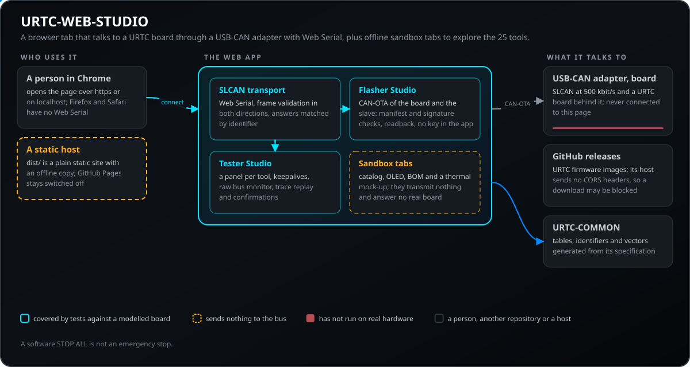
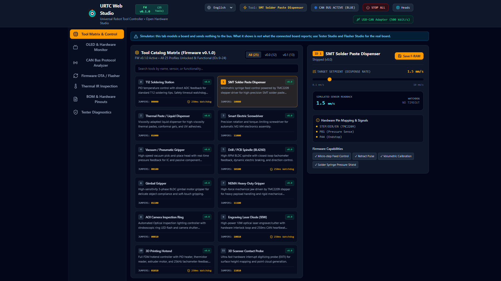
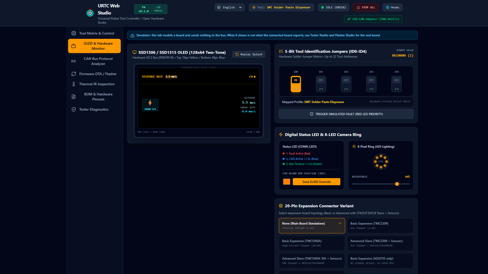
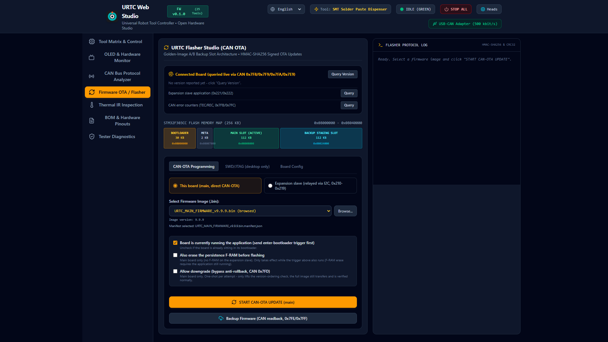
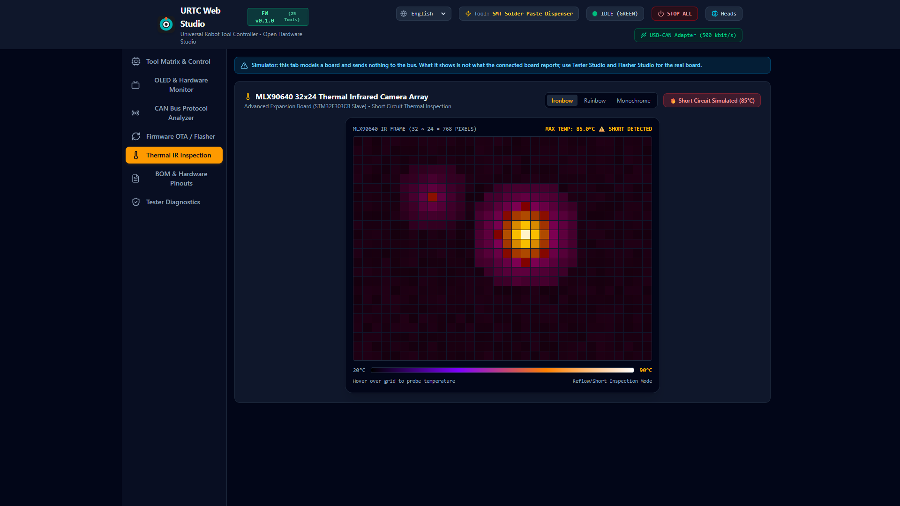
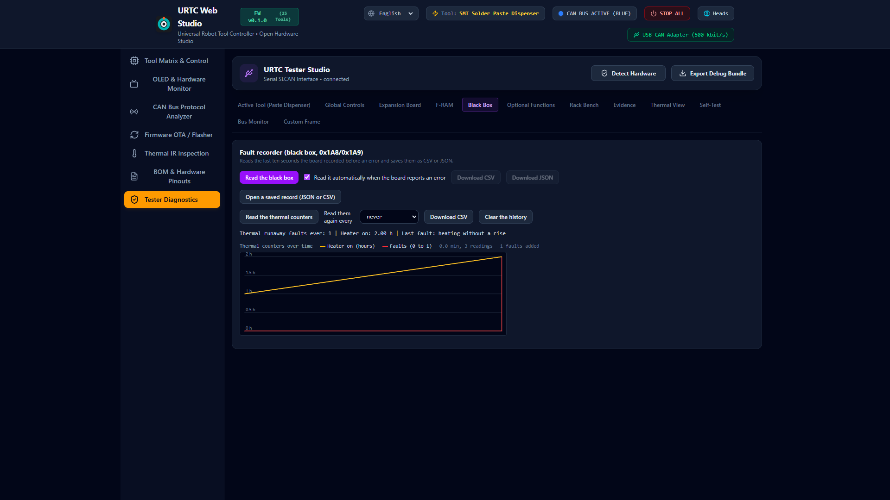
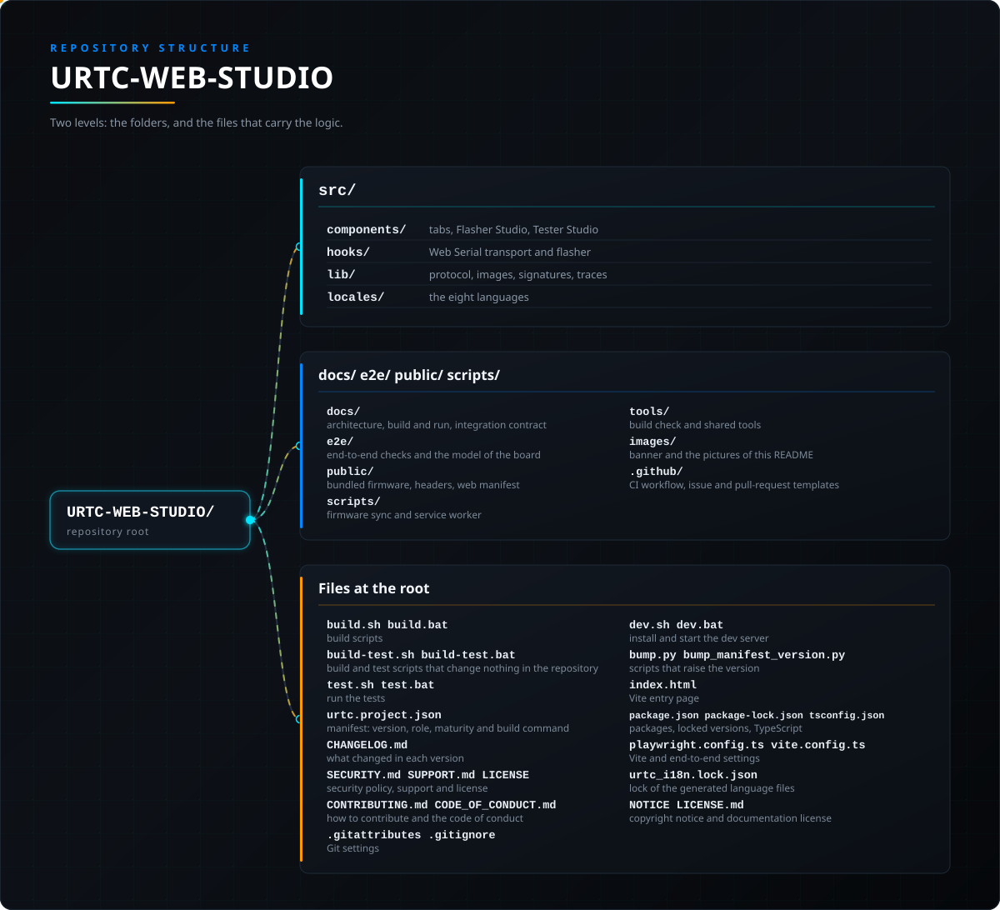

<p align="center">
  
</p>

# URTC Web Studio

<p align="center">
  <a href="README.md">🇺🇸 English</a> |
  🇪🇸 <b>Español</b> |
  <a href="README_fra.md">🇫🇷 Français</a> |
  <a href="README_ita.md">🇮🇹 Italiano</a> |
  <a href="README_deu.md">🇩🇪 Deutsch</a> |
  <a href="README_zho.md">🇨🇳 简体中文</a> |
  <a href="README_jpn.md">🇯🇵 日本語</a> |
  <a href="README_por.md">🇵🇹 Português</a>
</p>

### Los flujos principales del flasheador y del tester de URTC en una pestaña del navegador, con un adaptador USB-CAN y Web Serial

<p align="center">
  
  
  
  
</p>

---

**Comprobación de honestidad - lo que realmente funciona hoy:** `npm test` (Vitest) cubre la lógica pura: el análisis SLCAN, la correspondencia petición/respuesta, las comprobaciones de imagen de firmware y de manifiesto, los límites de las herramientas, las confirmaciones, las reglas que separan el simulador del bus real, la exportación de trazas y los ocho idiomas de la interfaz. Las pantallas y el propio transporte Web Serial no tienen tests unitarios (las comprobaciones de extremo a extremo del final de este párrafo los manejan frente a una placa modelada), y nada de esto se ha ejecutado contra una placa URTC real en este entorno (aquí no hay un adaptador USB-CAN con el que probarlo): Flasher Studio, Tester Studio y el Analizador de Protocolo CAN Bus son código real verificado solo con esos tests, la comprobación de tipos (`npm run lint`) y la revisión del código. Control/OLED/Specs-BOM/Thermal IR Inspection son pestañas de sandbox declaradas abiertamente como tales, sin tráfico CAN de ningún tipo. Consulta `CHANGELOG.md` para ver exactamente qué se ha entregado hasta ahora. `npm run test:e2e` además abre la página compilada en un navegador real (Playwright) frente a una placa modelada: así se comprueban la copia sin red, el historial de los contadores térmicos y la sesión guardada.

---

> **Estado de seguridad física y de ciberseguridad:** este ecosistema no es un sistema de seguridad certificado y todavía no existe ninguna placa URTC poblada. Los bootloaders comprueban las imágenes de firmware con CRC32 y un HMAC-SHA256 de clave compartida, no con una firma asimétrica (prevista); las imágenes de aplicación publicadas están firmadas con la clave pública de desarrollo (`signing_key_kind: dev`), así que cualquiera puede producir una imagen que el bootloader acepte; no se ha transmitido nada a una placa real. Lee la [línea base de seguridad](https://github.com/JuanenRac/URTC-DOCS/blob/main/docs/SECURITY_BASELINE.md) y el [modelo de amenazas](https://github.com/JuanenRac/URTC-DOCS/blob/main/docs/THREAT_MODEL.md) antes de fiarte de cualquier afirmación de aquí para la seguridad de una persona.

## 📋 De un vistazo

| | |
|---|---|
| Versión | `0.3.8` |
| Madurez | Funcional |
| Tests | 577 (`npm test`) |
| Tecnología | Web Serial API / TypeScript |
| Destino | Un navegador web en el PC del usuario |
| En hardware real | Solo simulado: probado con emuladores, dobles de prueba o simuladores; no consta ninguna ejecución en hardware real para esta versión |

**Ir a:** [Resumen](#-resumen) · [Arquitectura](#-arquitectura) · [Funciones](#-funciones) · [Seguridad](#-seguridad-y-protección) · [Interfaces](#-interfaces) · [Inicio rápido](#-inicio-rápido) · [Pruebas](#-pruebas) · [Estructura](#-estructura-del-repositorio) · [Relacionados](#-proyectos-relacionados)

<!-- urtc-section:status_web_studio -->
## 🚦 Estado del proyecto

🟢 hecho y verificado · 🟡 funciona, con límites conocidos · 🟠 a medias o sin verificar · 🔴 sin hacer o sin funcionar. Nada es verde si nunca corrió en hardware real.

| Parte | Estado | Lo que el repositorio puede demostrar |
| --- | :---: | --- |
| Software | 🟡 | Funciona en un PC y contra el simulador; nunca se ha usado con una placa real. |
| Interfaz | 🟡 | La ventana funciona y se comprueba contra una placa simulada; no se ha probado con un adaptador real. |
| Pruebas | 🟢 | La batería de pruebas pasa en la CI en cada subida. |
| Hardware real | 🟠 | Aún no se ha ejecutado con una placa real: la prueba de banco sigue pendiente. |
| Documentación | 🟡 | README en ocho idiomas y documentos de referencia; las traducciones no las ha revisado ningún hablante nativo. |

<!-- /urtc-section:status_web_studio -->

## 🎯 Resumen

Un compañero basado en navegador para el **Universal Robot Tool Controller (URTC)** -
una app de una sola página en React/Vite que está pensada para hablar con hardware URTC real (nunca se ha ejecutado con ninguno) a través de
un adaptador USB-CAN mediante la [Web Serial API](https://developer.mozilla.org/en-US/docs/Web/API/Web_Serial_API),
usando el mismo framing SLCAN y el mismo protocolo CAN que las dos herramientas
compañeras de escritorio, [URTC Flasher](https://github.com/JuanenRac/URTC-FLASHER) y
[URTC Tester](https://github.com/JuanenRac/URTC-TESTER). El objetivo es llevar los flujos principales de esas dos herramientas a una sola pestaña del navegador, no una demo simplificada de ellas; todavía no alcanza la paridad completa (véase «Aún no cubierto» más abajo) - las pestañas Flasher Studio y Tester Studio envían y
reciben las tramas CAN reales descritas en `docs/CANBUS.TXT` del
[repositorio de firmware de URTC](https://github.com/JuanenRac/URTC).

### Qué es real y qué es una sandbox

Esta app tiene dos tipos de pestañas:

- **Pestañas reales, dependientes de hardware** - Flasher Studio, Tester Studio, y el
  CAN Bus Protocol Analyzer. Estas solo hacen algo una vez que has conectado un
  adaptador USB-CAN real (botón de la cabecera arriba a la derecha); cada comando que
  envían y cada lectura que muestran proviene del bus CAN (este camino nunca se ha ejecutado con un adaptador ni una placa reales). Esto incluye la
  **lectura real de la cámara térmica** - el panel "Thermal Inspection" de Tester
  Studio (`0x250`/`0x251`/`0x254`/`0x255`) consulta el array IR MLX90640 real del
  cabezal de herramienta por CAN.
- **Pestañas sandbox sin conexión** - Control (catálogo de herramientas), OLED,
  Specs/BOM, y Thermal IR Inspection. Estas te permiten explorar el catálogo de 25
  herramientas, previsualizar las pantallas de estado OLED, navegar el BOM/pinouts, y
  ver una alimentación de cámara térmica simulada, todo sin ningún hardware conectado.
  El interruptor "FW v0.0 / v0.1" de la cabecera solo afecta a estas pestañas sandbox
  (qué perfiles de herramienta desbloquearía un build de firmware dado) - no tiene
  ninguna relación con lo que reporta una placa real conectada.
  - **No confundas las dos vistas térmicas**: la pestaña independiente "Thermal IR
    Inspection" (`ThermalCameraViewer.tsx`) es ruido `Math.random()` 100% del lado
    del cliente, sin ningún tráfico CAN en absoluto - es una maqueta de interfaz, no
    una lectura de sensor. Los datos reales de MLX9064x solo aparecen dentro del
    panel "Thermal Inspection" de Tester Studio, y solo una vez que hay hardware
    conectado.

## 🧩 Papel en URTC

URTC-WEB-STUDIO es la versión de navegador de los dos programas de escritorio de URTC, URTC-FLASHER y URTC-TESTER: una página React que habla con una placa URTC a través de un adaptador USB-CAN con Web Serial, con el mismo encuadre SLCAN y el mismo protocolo CAN (sus tablas y vectores se generan a partir de URTC-COMMON). Trae sus flujos principales a una pestaña del navegador sin instalar nada, y deja SWD/JTAG, que ningún navegador puede manejar, para el flasheador de escritorio. También tiene pestañas de zona de pruebas que exploran las 25 herramientas sin conexión y no transmiten nada.

## 🏛️ Arquitectura

<p align="center">
  
</p>

Cómo encajan las partes de este repositorio: quién lo usa, qué contiene y de qué depende. La imagen se dibuja desde `docs/architecture.json` y se comprueba contra el código.

### Stack tecnológico

- **Lenguaje:** TypeScript
- **Framework de frontend:** React 18
- **Herramienta de build:** Vite
- **Estilos:** Tailwind CSS
- **Iconos:** Lucide React
- **CRC32:** `crc-32` - comprobación de integridad de la imagen de firmware, refleja
  el propio cálculo de CRC32 del bootloader
- **Transporte de hardware:** Web Serial API + framing SLCAN (sin dependencias
  nativas, sin servidor backend compañero)

## 🖼️ Capturas de pantalla

<!-- urtc-shots -->
Capturadas a 1920×1080 en un banco de pruebas, con datos de ejemplo y sin ninguna instalación real detrás.

<table>
<tr>
<td width="50%" valign="top"><br><sub>Matriz de herramientas y control: los 25 perfiles de herramienta del firmware con sus puentes, y los controles de la herramienta seleccionada (pestaña de simulador: no envía nada al bus).</sub></td>
<td width="50%" valign="top"><br><sub>OLED y monitor de hardware: la pantalla de estado de la herramienta, los cinco puentes de identificación, el LED de estado y el anillo de 8 LED (pestaña de simulador).</sub></td>
</tr>
<tr>
<td width="50%" valign="top"><br><sub>Flasher: el mapa de flash de la placa, la imagen y su manifiesto listos para enviar, y las opciones de una actualización CAN-OTA (placa modelada; no se envía nada).</sub></td>
<td width="50%" valign="top"><br><sub>Inspección térmica: una imagen en falso color de una matriz infrarroja de 32×24 con un punto caliente simulado (pestaña de simulador).</sub></td>
</tr>
<tr>
<td width="50%" valign="top"><br><sub>Diagnóstico del tester: la caja negra y los contadores térmicos a lo largo del tiempo, leídos de una placa modelada.</sub></td>
<td width="50%"></td>
</tr>
</table>
<!-- /urtc-shots -->

## ✨ Funciones

### Flasher Studio - cobertura real de funcionalidades

Portado desde el propio `flasher_protocol.py` de `URTC-FLASHER`, contra los mismos
CAN ID:

- **Actualización CAN-OTA de la placa principal** (`0x7F0`-`0x7F7`): disparador de
  entrada al bootloader, HMAC-SHA256 de clave compartida (probado solo contra un simulador), transferencia paginada con control de
  flujo por ACK de página y reintento/backoff, CRC32 + END_UPDATE con versión
  declarada, y manejo de estado terminal (incluida la recuperación de una trama de
  confirmación perdida de la misma forma que la herramienta de escritorio - vuelve a
  consultar la versión en vez de reportar un fallo falso).
- **Actualización CAN-OTA del esclavo de expansión** (`0x210`-`0x219`, relevada a
  través del propio puente I2C de la placa principal) - mismo esquema de
  firma/CRC, sin ACK de página ni heartbeat en esta ruta (coincide con el protocolo
  real; el progreso se sondea, no se empuja).
- **Autorización de downgrade** (`0x7FD`) - una casilla protegida por confirmación
  que autoriza al intento actual a saltarse la comprobación anti-rollback del
  bootloader, para un revert deliberado a una versión más antigua.
- **Borrado de F-RAM antes de flashear** (`0x192`), opcional, solo placa principal.
- **Consulta del contador de errores CAN** (`0x7FB`/`0x7FC`, TEC/REC leídos
  directamente de los propios registros de error del controlador CAN) - distingue un
  problema genuino de bus de uno del lado de la aplicación/bootloader.
- **Relectura/respaldo de firmware por CAN** (`0x7FE`/`0x7FF`) - lee el contenido
  actual del slot principal antes de que lo sobrescribas, a un ritmo de 2KB/página
  con ACKs del host, y lo guarda como una descarga `.bin`.
- **Consulta de versión de placa en vivo** (`0x7F8`/`0x7F9`/`0x7FA`/`0x7E9`) - muestra el
  respondedor real (app o bootloader), HardwareID, y versión, no un interruptor
  simulado.
- **Firma y resumen publicados** - cada imagen del build de URTC trae
  `<file>.manifest.json` (versión, `sha256` y el valor `hmac_sha256` que espera el bootloader, un HMAC-SHA256 de clave compartida y no una firma asimétrica) y `<file>.sha256`. La app envía esa firma publicada,
  un `sha256` del manifiesto que no coincide con el archivo **bloquea** la
  grabación, y la versión del manifiesto es la que se informa al bootloader.
  Un archivo elegido del disco no tiene manifiesto: solo se puede grabar con
  una clave de firma introducida para esa grabación (placas de banco), salvo
  que se elija junto con su `.manifest.json`.
- **Número de parche del firmware** (`0x7E9`, y el `0x218` ampliado del
  esclavo) - el firmware instalado y la imagen elegida se muestran como
  mayor.menor.parche. El parche solo interviene en la comparación cuando los
  dos lados lo traen, una placa anterior a esto (no envía `0x7E9`) sigue
  funcionando con mayor.menor, y el parche va en END_UPDATE solo hacia un
  bootloader que lo haya anunciado. El registro dice si la imagen es más
  antigua, igual o más nueva que lo que informó la placa.
- **Firmware de la release más reciente de GitHub** - los binarios son
  archivos adjuntos de la release de cada versión de URTC, no archivos de git.
  La lista sale de la API de releases de `JuanenRac/URTC` (solo las imágenes de
  aplicación de la placa elegida, cada una con su `.sha256` y su
  `.manifest.json`); una imagen descargada debe coincidir con los resúmenes que
  publica la release, y se mantienen las comprobaciones de imagen, manifiesto y
  firma. GitHub sirve los archivos desde un host que no envía cabeceras CORS,
  así que un navegador puede no poder descargarlos: el registro lo dice, y la
  imagen puede tomarse de la carpeta incluida, o descargarse de la página de la
  release y elegirse con Examinar junto con su `.manifest.json`.
- **Configuración de placa**: tipo de placa de expansión / variante de sensor
  MLX9064x / configuración de herramienta libre (pines ID `11111`) / información de
  periféricos y número de serie - `0x1A0`-`0x1A7`.

#### SWD/JTAG - no disponible desde un navegador, por diseño

No existe ninguna API web capaz de manejar una sonda de depuración SWD/JTAG - Web
Serial solo habla con dispositivos de framing serie (como un adaptador USB-CAN), no
con el protocolo propio de una sonda, y STM32CubeProgrammer/pyOCD son subprocesos
nativos que la herramienta de escritorio invoca. Esto es una limitación estructural
de ejecutarse en una sandbox de navegador, no una funcionalidad que falte aquí. La
pestaña SWD/JTAG de Flasher Studio explica los comandos exactos que la herramienta
de escritorio `URTC Flasher` ejecutaría localmente, como referencia - usa esa
herramienta directamente para programación de chip completo, comprobaciones de
option-byte/RDP, o un respaldo de flash completo antes de un borrado masivo.

### Tester Studio - cobertura real de funcionalidades

Portado desde los paneles del propio deck Qt Quick de `URTC-TESTER`
(`assets/qml/TesterDeck.qml`), contra los mismos CAN ID:

- Un panel por herramienta (soldador + alimentador de hilo, herramientas de
  movimiento de motor paso a paso compartidas, recogida por vacío, taladro, AOI,
  láser, calentador/movimiento/ventiladores de impresora 3D, sonda de escaneo,
  electroimán, soldador de punto/ultrasonidos, sonda voladora incl. la ruta
  avanzada ADS1115, curado UV, retrabajo con aire caliente, engarzado, inspección
  térmica, dispensado de pasta), cada uno enviando los bytes de comando reales de
  la herramienta y decodificando su telemetría real.
- **Casilla activa + keepalive** para toda herramienta con un watchdog de
  comunicación del lado del firmware (soldador, láser, curado UV, retrabajo con
  aire caliente, boquilla de impresora 3D - reenvío cada 150ms bajo un watchdog de
  250ms; ventilador de capa de impresora 3D - reenvío cada 400ms bajo su propio
  watchdog de 1000ms), con los mismos intervalos de reenvío que usa la
  herramienta de escritorio. Al desmarcarla, cambiar de panel o de pestaña,
  desconectar o cerrar la página se envía la orden de apagado de la herramienta.
- **Global Controls** (`0x100`), passthrough SPI de **Expansion Board** + consulta
  TMC DIAG0 (`0x180`-`0x183`), consulta/borrado de **F-RAM** (`0x190`-`0x192`),
  **Self-Test** (comprobaciones seguras, en reposo, por herramienta), un
  **Raw Bus Monitor** con exportación de traza `.trc`/`.asc`, y un inyector de
  **Custom Frame** con un intervalo de repetición opcional - validado como el
  propio inyector de tramas del CAN Bus Protocol Analyzer: un identificador fuera
  de `0`-`7FF`, un byte de datos no válido o más de 8 bytes se rechaza con un
  mensaje, nunca se enmascara, se descarta ni se recorta. Los identificadores que
  solo transmite la placa se rechazan, y las escrituras en la memoria de la placa,
  las órdenes del bootloader y las de actuadores se confirman antes.
- **Detect Hardware** consulta la herramienta activa real (`0x110`/`0x111`) y la
  versión de placa (`0x7F8`/`0x7F9`), y un error crítico declarado (`0x111` byte 1)
  aparece como un banner de fallo en vivo.

<!-- urtc-section:heads -->
### Varios cabezales en un bus

El firmware puede hacer que varios cabezales compartan un bus CAN (la extensión multinodo). Viene **desactivada por defecto**, y un bus con un solo cabezal funciona exactamente como antes. La ventana **Cabezales** encuentra los cabezales, lista cada uno con su dirección, herramienta y número de serie, y muestra su estado: listo, seleccionado, conflicto de dirección, fallo retenido, en su bootloader o perdido. Seleccionas uno, el programa pide confirmación y solo entonces le envía algo; mientras haya varios cabezales en el bus, un comando se rechaza hasta que uno esté seleccionado y lo haya confirmado. Si se pierde el cabezal seleccionado, todos los cabezales pasan a su estado seguro (una casilla de la ventana lo desactiva). Se ha probado solo contra un modelo del bus, no con placas. Véase `docs/MULTINODE.md` en URTC-COMMON.
<!-- /urtc-section:heads -->

## 🔒 Seguridad y protección

| Amenaza | Defensa |
|---|---|
| Una trama mal formada llega al cable o a la pantalla | Se validan ambas direcciones del enlace SLCAN: un identificador fuera de `0x000`-`0x7FF`, una carga de más de 8 bytes o un byte fuera de `0x00`-`0xFF` se rechaza antes de escribirse, y una línea entrante que no es una trama SLCAN real se descarta |
| Un secreto viaja en la página | La aplicación no lleva ninguna clave de firma: Flasher Studio solo envía la firma que la compilación de URTC publicó junto a cada imagen, así que la página puede alojarse públicamente |
| Una imagen de firmware equivocada o manipulada | Un manifiesto cuyo `sha256` no coincide con el archivo bloquea el flasheo; cada imagen de una release oficial lleva una firma de release Ed25519 que la página comprueba en el navegador antes de enviar la imagen |
| Una respuesta simulada tomada por real | Las pestañas de zona de pruebas no transmiten nada y, con una placa conectada, no responden nada; sus tramas se marcan SIM y una traza reproducida se marca REPLAY |
| Una acción sobre la placa por error | Láser, taladro, curado UV, soldadura, calentadores, movimiento, dosificación de pasta, escrituras en la memoria de la placa, tramas escritas a mano arriesgadas y una imagen firmada con la clave pública de desarrollo piden confirmación antes |
| Un actuador que se queda funcionando | Cada herramienta con perro guardián en el firmware se mantiene viva con un reenvío y se apaga al reemplazar el panel, cambiar de pestaña, desconectar la placa o cerrar la página; STOP ALL apaga todo lo que la página mantiene vivo |
| Una página que carga código de otro sitio | Una política de seguridad de contenido: scripts solo de la propia página, conexiones solo a ella misma y a GitHub |

STOP ALL es una orden de software, no una parada de emergencia, y ninguna de las comprobaciones anteriores es una función de seguridad.

### Separación del simulador y confirmaciones (comprobaciones de software, no funciones de seguridad)

- Las pestañas de sandbox (Control, OLED, Thermal IR) no transmiten nada. Sus tramas llevan la marca SIM y, mientras hay una placa conectada, no producen ninguna respuesta simulada. De los mensajes predefinidos del analizador de protocolo solo se envían a una placa conectada las consultas simples; el resto sigue siendo simulado.
- Tester Studio muestra un panel de herramienta solo para la herramienta que la propia placa ha comunicado (`0x111`), y ninguno antes de que la placa responda.
- Láser, taladro, curado UV, soldadura, calentadores, movimiento, dispensado de pasta, escrituras en la memoria de la placa y tramas escritas a mano que entrañan riesgo piden confirmación antes.
- **PARAR TODO** en la cabecera (visible con la conexión activa) apaga todos los actuadores que esta página mantiene activos; cerrar la página y desconectar hacen lo mismo. Es una orden de software, no una parada de emergencia.
- Flashear una imagen firmada con la clave de desarrollo pública pide confirmación antes, porque esa clave no demuestra quién hizo la imagen.
- Cuando la placa declara un error crítico, el aviso indica también el motivo de la protección contra fuga térmica si la placa lo comunica.
- **Reproducción de una traza grabada** (CAN Bus Protocol Analyzer): un archivo `.trc` o `.asc`, por ejemplo el que exporta el Raw Bus Monitor, reproduce sus tramas recibidas en el registro y en los paneles sin placa, de 0,25x a 10x y opcionalmente en bucle. Las tramas se marcan REPLAY, no se transmite nada, una grabación nunca responde a una petición, nunca se exporta como algo que dijo la placa y la reproducción se pausa mientras haya una placa conectada.

### Nota de seguridad: esta app no lleva clave de firma

Desde la 0.2.3 esta app **no** contiene ninguna clave de firma HMAC-SHA256.
El build de URTC firma él mismo cada imagen de aplicación (con una clave privada solo en las versiones de release; las imágenes publicadas usan la clave pública de desarrollo) y publica la firma a su lado; Flasher
Studio solo transporta esa firma - el mismo modelo que el `URTC Flasher` de
escritorio. El bundle JS no contiene nada secreto, así que la página puede
publicarse abiertamente.

La única excepción es una imagen compilada por ti sin manifiesto, para una
placa de banco: la app pide entonces la clave de firma, la guarda en memoria
solo para esa grabación y nunca la almacena. Las imágenes firmadas con la
clave PÚBLICA de desarrollo (`signing_key_kind: "dev"` en el manifiesto)
solo se instalan en placas cuyo bootloader se compiló igual - el registro lo
indica. Ver `docs/FIRMWARE_SIGNING.TXT` de URTC.

La carpeta **no está en git**: la crea `npm run sync-firmware` (la CI y la compilación de Pages lo ejecutan antes de las pruebas y de la compilación). Mientras no exista una release oficial, el «latest» de GitHub responde 404 y `firmware-release.json` indica la release que se usa en su lugar (hoy la pre-release de banco); bórralo, o cambia su etiqueta, cuando se publique una oficial. **Seguridad de la página**: los scripts, los estilos, las fuentes y las imágenes vienen de la propia página (las fuentes van empaquetadas con la aplicación, no se pide nada a un servidor de fuentes), solo se permiten en línea los atributos de estilo que escribe React, y la página solo puede llegar a su propio origen y a los servidores de GitHub que sirven las releases (Content-Security-Policy en el `index.html` compilado). Un servidor que pueda enviar cabeceras usa `public/_headers` (la misma política, `Permissions-Policy: serial=(self)` y nada más potente); GitHub Pages no puede enviar cabeceras, así que allí solo vale la política que lleva la propia página.

`public/firmware/` contiene exactamente los archivos que publicó URTC (mismos
nombres, mismos bytes, con sus archivos adjuntos). Los binarios de URTC no
están en git: son archivos adjuntos de la release de cada versión.
`npm run sync-firmware` descarga la release más reciente
(`npm run sync-firmware -- --tag v0.3.5` para una concreta), o toma una carpeta
local como argumento (`npm run sync-firmware -- ../URTC/firmware` para un
build de banco). En ambos casos comprueba cada resumen y los campos de firma
antes de tocar `public/firmware/`, y regenera `src/lib/bundledFirmware.ts`; un
test verifica el paquete contra sus manifiestos.

Cada archivo de una release oficial tiene una firma de release (`<archivo>.sig`, Ed25519): la sincronización la verifica cuando existe y rechaza una incorrecta; un conjunto sin firmas (una pre-release de banco o una compilación local) necesita `--allow-unsigned`. La página comprueba la misma firma en el navegador (Web Crypto) antes de enviar a una placa una imagen incluida o una imagen de una release de GitHub, y se detiene si no es válida.

## 🔌 Interfaces

- Un adaptador USB-CAN ejecutando firmware **SLCAN** (p. ej. un CANable ejecutando
  `candlelight`/`slcan`, o cualquier adaptador que hable el protocolo serie SLCAN
  `lawicel` estándar) - la misma clase de adaptador que soportan ambas herramientas de
  escritorio a través de su propio transporte Serial.
- El bus configurado a **500 kbit/s**. Al conectar, la app prueba por turnos 500, 250, 125 kbit/s y el resto de velocidades estándar, y se queda con la primera en la que una placa responde a una consulta de versión; todavía no se puede elegir la velocidad a mano ni escuchar sin que una placa responda.
- Un navegador con soporte de Web Serial - **Chrome o Edge**. Firefox y Safari no
  implementan Web Serial y no podrán conectar en absoluto.
- Web Serial requiere un contexto seguro (HTTPS) o `localhost` - y no se puede usar
  desde dentro de un iframe. Si estás previsualizando esta app dentro de un frame
  incrustado, ábrela primero en su propia pestaña.

### Validación de tramas CAN

Ambas direcciones del enlace SLCAN se validan antes de que nada llegue a la
UI o al cable (`src/hooks/useSerialCanBus.ts`):

- **Saliente** - `sendFrame()` se niega a serializar un comando cuyo
  identificador quede fuera del rango CAN estándar de 11 bits
  (`0x000`-`0x7FF`), cuyo payload supere los 8 bytes, o cuyo payload
  contenga un byte fuera de `0x00`-`0xFF`. La UI muestra "Refusing malformed
  CAN frame: ..." en vez de escribir texto inválido al puerto serie.
- **Entrante** - `processBuffer()` exige una coincidencia real
  `t<3 hex ID><1 hex DLC 0-8><payload hex>` antes de convertir una línea
  SLCAN recibida en un `CanFrame`; un DLC fuera de `0`-`8` o un payload más
  corto que su propia longitud declarada se registra en consola y se
  descarta en vez de entregarse a un panel de herramienta como un byte
  `NaN`. Una marca de tiempo opcional del adaptador al final sigue
  aceptándose después de un payload válido.

## 🚀 Inicio rápido

### Requisitos previos

- Node.js 20 LTS+
- npm

### Instalación

```bash
git clone https://github.com/JuanenRac/URTC-WEB-STUDIO.git
cd URTC-WEB-STUDIO
npm install
```

### Modo desarrollo

Ejecuta la app con el servidor de desarrollo de Vite y recarga en vivo:
- **Windows:** doble clic en `dev.bat` o ejecuta `npm run dev`
- **Linux/Mac:** ejecuta `./dev.sh` o `npm run dev`

Luego abre `http://localhost:3000` en Chrome o Edge.

El servidor de desarrollo escucha solo en `localhost`: Web Serial funciona con https o en localhost, así que abrirlo a la red no aportaría nada.

### Build estático

Compila en un bundle estático y optimizado en `dist/`:
- **Windows:** doble clic en `build.bat` o ejecuta `npm run build`
- **Linux/Mac:** ejecuta `./build.sh` o `npm run build`

Este es un sitio estático plano - no hay ningún componente de servidor incluido (a
diferencia del propio `server.ts` de `HYDRA-UMC STUDIO`). Previsualiza la carpeta
`dist/` compilada localmente con:

```bash
npm run preview
```

o sirve `dist/` con cualquier host de archivos estáticos de tu elección. `npm run
lint` ejecuta el compilador de TypeScript en modo de solo comprobación.

La página compilada declara una política de seguridad de contenido (scripts solo de la propia página; conexiones solo a ella misma y a GitHub) y carga cada pestaña al abrirla por primera vez. `npm run test:e2e` la maneja en un Chromium real frente a una placa modelada; no se ha probado con un adaptador real.

<!-- urtc-section:compatibility -->
### Requisitos y compatibilidad

Qué versiones de los programas de URTC funcionan juntas, y qué versión del protocolo habla cada una, figura en la tabla de compatibilidad que genera URTC-COMMON: [docs/COMPATIBILITY.md](https://github.com/JuanenRac/URTC/blob/main/docs/COMPATIBILITY.md).
<!-- /urtc-section:compatibility -->

## 🧪 Pruebas

`npm test` (Vitest) ejecuta 577 pruebas de la lógica pura: análisis de SLCAN, emparejamiento de peticiones y respuestas, comprobaciones de imágenes de firmware y manifiestos, firmas de release, límites de herramienta, confirmaciones, las reglas que separan el simulador del bus real, exportación y reproducción de trazas, el selector de nodos, el simulador del rack, el registro de sesión guardado, la copia sin conexión, la sincronización del firmware y los ocho idiomas de la interfaz. `npm run lint` comprueba los tipos del código y `npm run test:e2e` ejecuta 19 comprobaciones de extremo a extremo en un Chromium real contra un adaptador y una placa modelados (`npm run test:coverage` añade un mínimo de cobertura). Las pantallas y el transporte Web Serial no tienen pruebas unitarias propias; las comprobaciones de extremo a extremo los manejan. Nada de esto se ha ejecutado contra un adaptador o una placa reales.

## 🏗️ Compilación y publicación

### GitHub Pages (desactivado hasta que el dueño lo active)

El repositorio puede publicar el sitio compilado en GitHub Pages (flujo `.github/workflows/pages.yml`: `npm ci`, comprobación de tipos, pruebas, `npm run build` con la ruta base del proyecto, y después `upload-pages-artifact` y `deploy-pages`). **El flujo está desactivado**: sus dos trabajos solo se ejecutan cuando la variable del repositorio `URTC_PAGES_ENABLED` vale `true` (Settings > Secrets and variables > Actions > Variables), que el dueño pone tras la primera release oficial firmada de URTC. La compilación ejecuta entonces `npm run sync-firmware -- --require-official`: toma solo el firmware de la última release oficial (nunca una pre-release ni la etiqueta de reserva de `firmware-release.json`), rechaza cualquier archivo sin firma de release válida y cualquier imagen de aplicación compilada con la clave pública de desarrollo, de modo que la página publicada no puede llevar imágenes de la clave de desarrollo. Pages también debe activarse una vez (Settings > Pages > Source: GitHub Actions); con la variable sin definir el flujo se omite. Web Serial necesita un navegador basado en Chromium y https, que Pages proporciona.

La `version` de `package.json` y la de `urtc.project.json` solo cambian con un paso explícito (`python bump.py`, que mantiene las dos iguales y escribe la entrada del registro de cambios); `build.bat` / `build.sh`, `npm run build`, `npm run dev`, `npm run lint` y `npm run preview` nunca cambian la versión.

## 📂 Estructura del repositorio

<p align="center">
  
</p>

<details>
<summary>Versión en texto del árbol</summary>

```text
URTC-WEB-STUDIO/
├── src/                                           la aplicación: componentes, hooks, la lógica de CAN, SLCAN y firmware, los ocho archivos de idioma y las tablas generadas
├── docs/                                          arquitectura, compilación y ejecución, contrato de integración
├── e2e/                                           comprobaciones de extremo a extremo y el modelo de la placa
├── public/                                        firmware incluido, cabeceras, manifiesto web
├── scripts/                                       sincronización del firmware y service worker
├── tools/                                         comprobación de compilación y herramientas compartidas
├── images/                                        banner e imágenes de este README
├── .github/                                       flujo de CI y plantillas de issues y pull requests
├── build.sh build.bat                             scripts de compilación
├── build-test.sh build-test.bat                   scripts de compilación y pruebas que no cambian nada en el repositorio
├── test.sh test.bat                               ejecutan las pruebas
├── urtc.project.json                              manifiesto: versión, papel, madurez y comando de compilación
├── CHANGELOG.md                                   qué cambió en cada versión
├── SECURITY.md SUPPORT.md LICENSE                 política de seguridad, soporte y licencia
├── CONTRIBUTING.md CODE_OF_CONDUCT.md             cómo contribuir y código de conducta
├── .gitattributes .gitignore                      ajustes de Git
├── dev.sh dev.bat                                 instalar y arrancar el servidor de desarrollo
├── bump.py bump_manifest_version.py               scripts que suben la versión
├── index.html                                     página de entrada de Vite
├── package.json package-lock.json tsconfig.json   paquetes, versiones fijadas, TypeScript y Vite
├── playwright.config.ts vite.config.ts            ajustes de las comprobaciones de extremo a extremo
├── playwright.screenshots.config.ts               Ajustes de Playwright para las capturas del README
├── urtc_i18n.lock.json                            bloqueo de los archivos de idioma generados
└── NOTICE LICENSE.md                              aviso de copyright y licencia de la documentación
```

</details>

La lista anotada de cada archivo de código, una línea por archivo, está en [docs/SOURCE_MAP.md](docs/SOURCE_MAP.md).

## 🗺️ Hoja de ruta y límites conocidos

- Un modo solo escucha y elegir la velocidad a mano: no se puede entrar en un bus en el que ninguna placa responde.
- La lectura de la imagen térmica no comprueba antes que el sensor esté listo ni reintenta un bloque perdido.
- Descargar un archivo de firmware directamente de la release de GitHub dentro del navegador: GitHub sirve los archivos de una release desde un host sin cabeceras CORS, así que la descarga puede estar bloqueada (la imagen incluida, o un archivo elegido del disco con su `.manifest.json`, siempre funcionan).

## 🌍 Idiomas

El README y los textos existen en inglés, español, francés, italiano, alemán, chino, japonés y portugués de Portugal.

## 🔗 Proyectos relacionados

URTC se compone de repositorios independientes, cada uno con su versión, sus pruebas y su README. Esta es la familia, por grupos:

* **URTC Tool Platform:**
  * [URTC](https://github.com/JuanenRac/URTC) - firmware de la placa del cabezal de herramienta (25 perfiles de herramienta, bootloader CAN) y la referencia del protocolo CAN.
  * [URTC-COMMON](https://github.com/JuanenRac/URTC-COMMON) - el protocolo CAN escrito una sola vez como datos (especificación, tablas generadas, vectores de conformidad) y el código que comparten los programas.
  * [URTC-FLASHER](https://github.com/JuanenRac/URTC-FLASHER) - herramienta de escritorio que actualiza el firmware de la placa por CAN o por SWD/JTAG.
  * [URTC-GATEWAY](https://github.com/JuanenRac/URTC-GATEWAY) - pasarela delante del bus CAN: solo deja pasar los identificadores de una lista, limita su frecuencia y pide una clave de sesión.
  * [URTC-SMART-RACK](https://github.com/JuanenRac/URTC-SMART-RACK) - lógica en C independiente del hardware y protocolo de órdenes para un soporte de herramientas con precalentamiento y seguimiento del ciclo de vida.
  * [URTC-TESTER](https://github.com/JuanenRac/URTC-TESTER) - probador de escritorio del bus CAN en vivo que muestra los controles y la telemetría del perfil de herramienta que informa una placa.
  * [URTC-VISION-TOOL](https://github.com/JuanenRac/URTC-VISION-TOOL) - protocolo de tramas de sensor en C y un acompañante en Python térmico/RGB para un cabezal de inspección.
  * **URTC-WEB-STUDIO** (este repositorio) - aplicación de navegador que graba y prueba la placa por Web Serial y SLCAN, sin instalar nada.
* **Ecosystem Operations:**
  * [URTC-DEVTOOLS](https://github.com/JuanenRac/URTC-DEVTOOLS) - las herramientas de repositorio compartidas de la familia como un conjunto con versión y un fichero de bloqueo que distingue una copia editada de una desfasada.
  * [URTC-DOCS](https://github.com/JuanenRac/URTC-DOCS) - arquitectura, interfaces, línea base de seguridad y catálogo generado del ecosistema, más las herramientas que comparan todos los repositorios.
  * [URTC-UPDATER](https://github.com/JuanenRac/URTC-UPDATER) - herramienta de escritorio que detecta, instala y actualiza los repositorios de la familia URTC, una acción explícita cada vez.

**Proyectos hermanos (independientes, con la misma base y herramientas):**

* **[HYDRA-UMC-DOCS](https://github.com/JuanenRac/HYDRA-UMC-DOCS)** - proyecto hermano: el centro de documentación de HYDRA-UMC, un ecosistema independiente que comparte base y herramientas con este
* **[ARMOR-DOCS](https://github.com/JuanenRac/ARMOR-DOCS)** - proyecto hermano: el centro de documentación de A.R.M.O.R., el ecosistema de seguridad, también independiente y sobre la misma base
* **[JuanenRac](https://github.com/JuanenRac/JuanenRac)** - el perfil y el panel de estado de todos los ecosistemas

## 📚 Documentación

- [`docs/ARCHITECTURE.md`](docs/ARCHITECTURE.md) — cómo la UI, la
  configuración persistida y la autoridad del transporte externo se
  mantienen separadas, y por qué las pestañas sandbox deben exponer
  estados offline/no disponible en vez de presentar datos simulados como
  reales.
- [`docs/BUILD_AND_RUN.md`](docs/BUILD_AND_RUN.md) — el camino de
  validación no mutante `build-test.bat`/`.sh` (TypeScript + tests, sin
  cambios de versión ni CHANGELOG), `dev.bat`/`.sh` para desarrollo local,
  y por qué el material de firma OTA nunca pertenece a la configuración
  del navegador.
- [`docs/INTEGRATION_CONTRACT.md`](docs/INTEGRATION_CONTRACT.md) — qué debe
  hacer este cliente ante un esquema desconocido, una identidad de destino
  ausente o un resultado de API malformado, y por qué la autoridad real de
  flasheo se mantiene en el servidor o en las herramientas de escritorio
  dedicadas.

- **[CONTRIBUTING.md](CONTRIBUTING.md)** — stack tecnológico y pautas de codificación para un pull request.
- **[CODE_OF_CONDUCT.md](CODE_OF_CONDUCT.md)** — los estándares de comportamiento esperados en esta comunidad.
- **[SECURITY.md](SECURITY.md)** — cómo reportar una vulnerabilidad, y las áreas reales de enfoque en seguridad de este proyecto.
- **[SUPPORT.md](SUPPORT.md)** — dónde hacer preguntas y reportar errores.
- **[LICENSE.md](LICENSE.md)** — la licencia propia de este proyecto.

## 🤝 Contribuir y comunidad

* Antes de una pull request ejecuta `URTC_CI=1 python tools/ci_validate.py`: debe pasar. Consulta [CONTRIBUTING.md](CONTRIBUTING.md) y el [código de conducta](CODE_OF_CONDUCT.md).
* El README existe en ocho idiomas: un cambio en el texto se hace en los ocho archivos, y las secciones compartidas con otros repositorios las escribe `tools/readme_sections.py` de URTC-COMMON.
* Un cambio en el protocolo CAN empieza en URTC-COMMON (`spec/can_protocol.json`) y llega a este repositorio mediante la copia comprobada.
* No describas como funcionando en una placa lo que solo se ha compilado.
* Informa de una vulnerabilidad en privado: [SECURITY.md](SECURITY.md). Preguntas, ideas e informes: electrohobby3d@gmail.com ([SUPPORT.md](SUPPORT.md)).

## 👤 AUTOR

**JuanenRac** (Electro Hobby 3D)
📧 electrohobby3d@gmail.com
📺 [youtube.com/@electrohobby3d](https://youtube.com/@electrohobby3d)

## 📜 LICENCIA

URTC Web Studio es (c) 2026 JuanenRac (Electro Hobby 3D). Este aviso debe incluirse
en cualquier distribución de este proyecto o trabajos derivados.

Este proyecto consiste en código fuente y su propia documentación, disponibles bajo
licencias distintas - cada una adecuada a lo que realmente cubre:

1. El código fuente (todo lo que está bajo `src/`, más la configuración de
   Vite/TypeScript que lo compila) está disponible bajo la **GNU General Public
   License v3.0 (GPL-3.0-or-later)**. Texto completo en
   https://www.gnu.org/licenses/gpl-3.0.html.

2. La documentación (este README y sus propias traducciones - `README_spa.md`,
   `README_ita.md`, `README_fra.md`, `README_deu.md`, `README_zho.md`,
   `README_jpn.md`) está disponible bajo
   **Creative Commons Attribution-ShareAlike 4.0 International (CC BY-SA 4.0)**.
   Texto completo en https://creativecommons.org/licenses/by-sa/4.0/.

Esta herramienta es el compañero basado en navegador del proyecto
[URTC (Universal Robot Tool Controller)](https://github.com/JuanenRac/URTC) - ver el
propio repositorio de ese proyecto para el firmware de la placa, los diseños de
hardware, y la documentación completa del protocolo contra la que trabaja esta
herramienta. El propio firmware de URTC es GPL-3.0-or-later y sus diseños de hardware son
CERN-OHL-S v2; la propia licencia de esta herramienta aquí no se extiende a ese
proyecto separado, y viceversa. También existen 2 alternativas nativas de
escritorio que cubren el mismo terreno:
[URTC Flasher](https://github.com/JuanenRac/URTC-FLASHER) y
[URTC Tester](https://github.com/JuanenRac/URTC-TESTER).

Si construyes sobre este proyecto, ten en cuenta la separación de licencias: los
cambios de código deberían mantenerse GPL-3.0-or-later, los derivados de documentación
deberían mantenerse CC BY-SA - cada uno con atribución de vuelta a este proyecto y
su autor.

**Pestañas Caja negra, Funciones opcionales, Banco de rack y Vista térmica (nuevas, comprobadas solo con simulaciones):** Tester Studio lee el registrador de fallos (`0x1A8` / `0x1A9`) y lo descarga como CSV o JSON, automáticamente una vez por cada error que la placa indica cuando esa opción está activada; activa las funciones opcionales del firmware (`0x1AE` / `0x1AF`, apagadas por defecto, tras una confirmación; actúan tras el próximo arranque); simula el rack de herramientas en la página, con la identidad de cada cabezal (tipo y número de serie); y dibuja la imagen de inspección térmica en falso color (una imagen simulada lo dice). El catálogo de herramientas ahora sale de los perfiles de herramienta compartidos de URTC-COMMON. Nada de esto se ha probado con una placa real.

**Visor de la caja negra (nuevo, comprobado solo con tests):** la pestaña Black Box dibuja la temperatura medida y la consigna de los segundos grabados antes del error, con una línea donde aparece por primera vez el indicador de error, y abre un registro guardado antes (el archivo JSON o CSV que escribe la propia pestaña) sin placa conectada; un archivo que no es un registro, tiene un valor fuera de rango o más de 67 muestras se rechaza con el motivo.

**Copia sin red e instalación (nuevo, comprobado solo con tests y un navegador):** la compilación escribe un service worker (`sw.js`) y un manifiesto de aplicación web; tras la primera visita por https (o en localhost) el navegador guarda la página, sus scripts y el firmware incluido, la cabecera dice **Funciona sin red** y el Studio se abre sin conexión (entonces la cabecera dice **Sin red**); donde el navegador lo ofrece, un botón **Instalar** instala el Studio como aplicación. La página y el manifiesto del firmware se piden siempre primero a la red, de modo que quien está conectado recibe los más nuevos; `version.json` nunca se responde desde la copia; una versión nueva espera a que se cierren las pestañas abiertas antes de tomar el control. La API de GitHub no se guarda: sin red no se puede consultar la última release y solo se usan las imágenes incluidas.

**Contadores térmicos a lo largo del tiempo (nuevo, comprobado solo con tests y una placa modelada):** en la pestaña Caja negra los contadores térmicos de por vida (`0x1AA` / `0x1AB`) se pueden volver a leer cada 10 s, 30 s, 1 min o 5 min; cada lectura se añade a un historial guardado en el navegador que dibuja las horas del calentador y los fallos a lo largo del tiempo, se puede descargar como CSV y borrar; un contador que baja (otra placa) reinicia el historial.

**Sesión guardada (nuevo, comprobado solo con tests y una placa modelada):** el Monitor de bus guarda las tramas como un log y un registro que nombra el log por su SHA-256 y su tamaño, con el mismo formato que escribe el Tester de escritorio; **Comprobar una sesión guardada** toma el registro y su log y dice si van juntos. Demuestra que un log no se editó. Donde el navegador sabe hacer firmas Ed25519, el registro lleva además una firma hecha con una clave de este navegador (se crea al primer uso y se guarda en el navegador): demuestra que el registro no se editó después de firmarse, y no dice quién tiene la clave. El monitor también puede mostrar solo los ID que escribas, o solo las tramas cuyos datos cambiaron (la tasa y la carga siguen contando todas las tramas).

**Aviso de versión (nuevo, comprobado solo con tests):** la compilación escribe un `version.json` junto a la página; la página compilada lo compara una vez, al abrirse y solo con su mismo origen, con su propia versión y avisa cuando se sirve una mayor, con un botón Recargar. Nada se recarga solo, una versión igual o anterior no dice nada y un archivo ausente o la falta de red pasan en silencio.

**PID del calentador (en la pestaña Funciones opcionales; nuevo, comprobado solo con simulaciones):** Tester Studio lee el estado del PID del calentador del firmware (`0x1B9` / `0x1BA`: las ganancias en vigor, el estado y la salida del último ciclo de control), guarda ganancias (de 0 a 600) y inicia o cancela el autoajuste por relé, que calienta la punta alrededor de la consigna actual del soldador (100 a 445 C) y guarda las ganancias que encuentra. Guardar ganancias e iniciar el autoajuste piden confirmación; cancelar no; una ganancia que no sea un número de 0 a 600 se rechaza antes de enviar nada. Hay que activar antes la función entre las funciones opcionales; nada de esto se ha probado con una placa real.
